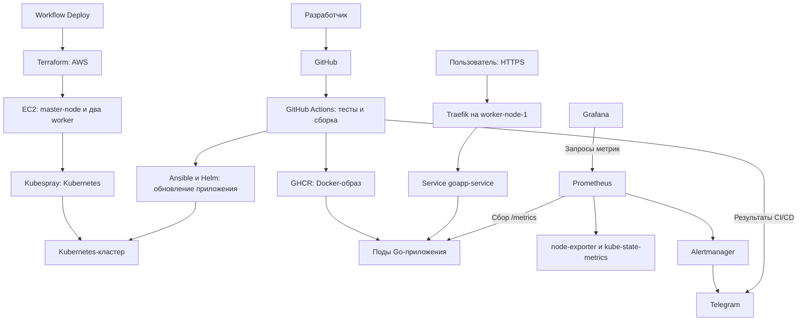

# Автоматизация CI/CD Go-приложения в AWS и Kubernetes

Дипломный проект Сороквашин Матвеq, группа DOS35.

Проект демонстрирует создание инфраструктуры средствами Infrastructure as Code,
сборку и тестирование Go-приложения, публикацию Docker-образов, развёртывание
в Kubernetes и мониторинг с уведомлениями в Telegram.

Репозиторий: [Matthew62s/Diplom_SOROKVASHIN_DOS35](https://github.com/Matthew62s/Diplom_SOROKVASHIN_DOS35).
Основа приложения — [Go Hello World](https://github.com/hackersandslackers/golang-helloworld).

## Архитектура



Terraform создаёт VPC, публичные и приватные подсети, internet Gateway,
маршрутизацию, Security Group, SSH key pair и три EC2-инстанса.
Kubespray устанавливает Kubernetes: один control-plane/etcd и два worker-узла.
Все три EC2 в текущем коде размещаются в первой публичной подсети.
Это учебный кластер с единственным control-plane, без отказоустойчивости etcd.

| Компонент             | Размещение и назначение                                            |
| --------------------- | ------------------------------------------------------------------ |
| Go-приложение         | Namespace `default`, Deployment `goapp`, порт контейнера `8080`    |
| Service приложения    | `goapp-service`, ClusterIP, порт `80` → `8080`                     |
| Helm-релиз приложения | `my-diplom-app`                                                    |
| Traefik               | Namespace `default`, привязан к `worker-node-1`, hostPort `80/443` |
| Мониторинг            | Namespace `monitoring`, Helm-релиз `monitoring`                    |
| Prometheus            | Сбор метрик Kubernetes, узлов и приложения                         |
| Grafana               | Визуализация метрик, доступ через Traefik                          |
| Alertmanager          | Маршрутизация алертов приложения в Telegram                        |

## Инструменты

| Инструмент                      | Роль                                                     |
| ------------------------------- | -------------------------------------------------------- |
| AWS EC2, VPC, S3                | Вычислительные ресурсы, сеть и удалённый Terraform state |
| Terraform                       | Декларативное описание AWS-инфраструктуры                |
| Ansible, Kubespray `v2.26.0`    | Настройка серверов и установка Kubernetes                |
| Go 1.25                         | HTTP-приложение и автотесты                              |
| Docker                          | Многоэтапная сборка и запуск приложения без root         |
| GitHub Actions, GHCR            | CI/CD и хранение образов                                 |
| Helm                            | Установка приложения, Traefik и мониторинга              |
| Traefik, Let's Encrypt          | Ingress и HTTPS с ACME HTTP-01                           |
| Prometheus Operator             | Управление Prometheus, ServiceMonitor и PrometheusRule   |
| kube-prometheus-stack `92.10.1` | Prometheus, Grafana, Alertmanager и exporters            |
| Super-linter, Trivy             | Проверки исходников, конфигураций и зависимостей         |
| Cosign                          | Подписание опубликованных Docker-образов                 |
| Telegram Bot API                | Уведомления CI/CD и Alertmanager                         |

Точные версии зависимостей приложения находятся в [go.mod](go.mod) и [go.sum](go.sum).
AWS provider в Terraform имеет диапазон версий; Traefik устанавливается без
фиксированной версии чарта. Эти зависимости пока не полностью закреплены.

## Структура репозитория

```text
.github/workflows/
├── CI.yml                    # Проверки, образ, деплой из main, уведомления
├── deploy.yml                # Создание AWS и установка Kubernetes/компонентов
├── setup.yml                 # Повторная настройка существующих серверов
└── terraform_destroy.yml     # Планирование и удаление AWS-инфраструктуры
Ansible/
├── add_config_k8s.yml         # Kubeconfig для admin
├── deploy_app.yml            # Обновление приложения с заданным тегом образа
├── helm_install.yml          # Установка Helm на master
├── helm_push.yml             # Чарт приложения, Traefik и хранилище сертификатов
└── monitoring.yml            # Secrets, стек мониторинга и правила алертов
Helm_go/
├── Chart.yaml
├── values.yaml
└── templates/                # Deployment, Service, Ingress, HPA, ServiceMonitor
Monitoring/
├── values.yaml               # Grafana, Prometheus и Telegram receiver
└── goapp-alerts.yaml          # Правила алертов приложения
Terraform/
├── main.tf                   # Ресурсы AWS и S3 backend
├── variable.tf               # Входные параметры
└── outputs.tf                # Адреса и имена серверов
Dockerfile                    # Сборка и runtime-образ
main.go                       # HTTP-сервис и метрики
main_test.go                  # Тесты обработчиков и инструментирования
tests/smoke.sh                # HTTP-проверки собранного Docker-образа
```

## Подготовка окружения

Для локальной разработки нужны Git, Go 1.25 или совместимая более новая версия,
Docker и cURL. Для smoke-теста нужны Bash, diff и grep; на Windows можно
использовать WSL или Git Bash. Race detector требует доступного C toolchain.

Для развёртывания нужны AWS-аккаунт, доступный GitHub Actions runner,
SSH-доступ к EC2 и DNS-зона в Cloudflare. По умолчанию используются регион
`eu-central-1` и инстансы `t3.small`; параметры находятся в
[Terraform/variable.tf](Terraform/variable.tf). Для стека мониторинга может
потребоваться увеличение ресурсов узлов.

### GitHub Secrets и Variables

Создайте GitHub Environment `production`. Secrets, используемые jobs с
`environment: production`, можно хранить в этом окружении. Настройки:
**Settings → Environments → production**.

| Secret                   | Назначение                                                                 |
| ------------------------ | -------------------------------------------------------------------------- |
| `AWS_ACCESS_KEY_ID`      | AWS-доступ для Terraform и S3 backend                                      |
| `AWS_SECRET_ACCESS_KEY`  | Секретный AWS access key                                                   |
| `SSH_PRIVATE_KEY`        | Приватный ключ для подключения Ansible к EC2                               |
| `GH_TOKEN`               | Чтение образов GHCR при создании `ghcr-cred`; обычно PAT с `read:packages` |
| `FINE_TOKEN`             | GitHub API: чтение и изменение Actions Variables репозитория               |
| `CLOUDFLARE_API_TOKEN`   | Изменение DNS-записи в используемой зоне Cloudflare                        |
| `GRAFANA_ADMIN_PASSWORD` | Начальный пароль администратора Grafana                                    |
| `TELEGRAM_BOT_TOKEN`     | Telegram-бот для алертов и уведомлений CI/CD                               |

`GITHUB_TOKEN` выдаётся GitHub Actions автоматически. В job сборки он используется
для публикации образов, статусов проверок и Git-тегов в пределах заданных permissions.
Для `FINE_TOKEN` требуется доступ к выбранному репозиторию и разрешение
**Variables: Read and write**. AWS-права должны позволять управление ресурсами
из Terraform и чтение/запись state в S3.

| Variable           | Назначение                                                  |
| ------------------ | ----------------------------------------------------------- |
| `MASTER_NODE_IP`   | Публичный IP master для SSH                                 |
| `WORKER_NODE1_IP`  | Публичный IP первого worker                                 |
| `WORKER_NODE2_IP`  | Публичный IP второго worker                                 |
| `TELEGRAM_CHAT_ID` | ID чата для уведомлений CI/CD; у групп обычно отрицательный |

IP-переменные создаются или обновляются workflow `Deploy` на уровне репозитория
после Terraform apply. Не задавайте устаревшие одноимённые переменные на уровне
Environment: они могут перекрыть значения репозитория.

Для Alertmanager `chat_id` отдельно задаётся в [Monitoring/values.yaml](Monitoring/values.yaml).
Изменение `TELEGRAM_CHAT_ID` в GitHub автоматически его не меняет.

Значения секретов не должны попадать в репозиторий, readme, логи и снимки экрана.

### SSH, Terraform backend и DNS

1. Приватный `SSH_PRIVATE_KEY` должен соответствовать публичному ключу в
   `aws_key_pair` в [Terraform/main.tf](Terraform/main.tf). Пользователь AMI
   должен соответствовать `ansible_user=admin`. Смена key pair не обновляет
   `authorized_keys` на уже работающих EC2.
2. S3 bucket из блока `backend "s3"` должен существовать **до** `terraform init`.
   Он не создаётся текущей Terraform-конфигурацией. Для другого AWS-аккаунта
   задайте свой bucket; рекомендуется включить versioning и ограничить доступ.
3. В `deploy.yml` сейчас указаны конкретные Cloudflare zone ID и record ID.
   Для другой зоны замените их. Workflow обновляет существующую A-запись,
   но не создаёт DNS-зону и все записи с нуля.
4. Домен приложения задаётся в `Helm_go/templates/ingress.yaml`, домен Grafana —
   в `Monitoring/values.yaml`. В текущем проекте это `oohjob.com` и
   `grafana.oohjob.com`. A-запись должна указывать на публичный IP `worker-node-1`;
   для Grafana допустим CNAME на основной домен.
5. Для ACME HTTP-01 узел Traefik должен быть доступен снаружи по TCP `80` и `443`.
   Адрес электронной почты ACME и настройки Traefik находятся в `Ansible/helm_push.yml`.

## Локальная сборка и тесты

```bash
git clone https://github.com/Matthew62s/Diplom_SOROKVASHIN_DOS35.git
cd Diplom_SOROKVASHIN_DOS35

go mod download
go test -mod=readonly -v ./...
go vet -mod=readonly ./...
go run .
```

В другом терминале:

```bash
curl -fsS http://127.0.0.1:8080/
curl -fsS http://127.0.0.1:8080/metrics
```

В Windows PowerShell используйте `curl.exe`. Ответ `/` содержит приветствие,
имя пода и адреса пода/узла. При локальном запуске соответствующие переменные
окружения могут быть пустыми. Неизвестный маршрут возвращает HTTP 404.

Go-тесты проверяют ответ приложения с заполненными и пустыми переменными
окружения, доступность метрик, рост счётчика запросов и histogram после запроса,
а также HTTP 404. В CI дополнительно включены race detector и отчёт покрытия:

```bash
go test -mod=readonly -race -coverprofile=coverage.out -v ./...
go tool cover -func=coverage.out
```

Проверка собранного Docker-образа:

```bash
docker build -t goapp:test .
bash tests/smoke.sh goapp:test
```

Smoke-тест запускает временный контейнер на свободном loopback-порту, проверяет
`/`, `/metrics` и отсутствующий маршрут. При ошибке выводит логи, затем удаляет
контейнер. Для ручного запуска приложения в Docker:

```bash
docker run --rm -p 127.0.0.1:8080:8080 goapp:test
```

## CI/CD

### CI.yml — проверки и обновление приложения

[CI.yml](.github/workflows/CI.yml) запускается при push в любую ветку
и pull request в `main`.

1. Выполняет Go-тесты с race detector, Helm lint/render и Super-linter.
2. Собирает образ и загружает его в локальный Docker runner.
3. Проверяет собранный образ через `tests/smoke.sh`.
4. При push публикует **проверенный образ** в GHCR и подписывает через Cosign.
   На pull request публикация не выполняется.
5. Для push в `main` вычисляет очередной patch-тег `vX.Y.Z`, публикует Git-тег
   и запускает обновление приложения на существующем кластере.
6. Через Ansible обновляет чарт/Traefik, устанавливает версию приложения с
   `image.tag` из сборки и применяет настройки мониторинга.
7. Job `notify` отправляет в Telegram результаты build/deploy, ветку, commit
   и ссылку на запуск. Для других веток `Deploy: skipped` ожидаем.

Имя образа формируется из `github.repository`. При использовании форка также
измените `image.repository` в `Helm_go/values.yaml`. Деплой из `main` предполагает,
что AWS-инфраструктура и Kubernetes уже созданы.

### Deploy — подготовка инфраструктуры

[deploy.yml](.github/workflows/deploy.yml) запускается вручную:
**Actions → Deploy → Run workflow → apply**.

После подготовки prerequisites и устранения ограничений из раздела ниже
запуск можно выполнить одной командой GitHub CLI:

```bash
gh workflow run deploy.yml --ref main -f apply=true
```

Workflow проверяет код и Docker-образ, выполняет Terraform plan/apply,
получает адреса EC2, обновляет GitHub Variables и DNS, устанавливает Kubernetes
через Kubespray, настраивает kubeconfig и GHCR, запускает playbooks приложения,
Traefik и мониторинга.

При `apply=false` Terraform apply и основные шаги настройки серверов пропускаются.
Это **не полностью автономный dry-run**: для plan нужны AWS/S3-доступ и state;
шаг мониторинга пока не ограничен этим флагом (см. ограничения).

Первый релиз приложения использует тег `latest`, поэтому доступный образ в GHCR
должен существовать заранее. Его публикует job build из `CI.yml` при push;
успех этой сборки не означает успешный деплой на ещё не созданный кластер.

[setup.yml](.github/workflows/setup.yml) — отдельный ручной workflow `Setup`
для настройки уже существующих серверов. Он не создаёт EC2 и не заменяет
установку Kubernetes через `Deploy`.

## Мониторинг и уведомления

Prometheus получает метрики Go-приложения через `ServiceMonitor` с label
`release: monitoring`. Метрики узлов собирает node-exporter, состояние объектов
Kubernetes — kube-state-metrics. Grafana обращается к Prometheus как источнику данных.

| Метрика                               | Назначение                                     |
| ------------------------------------- | ---------------------------------------------- |
| `goapp_http_requests_total`           | Количество запросов с labels `code` и `method` |
| `goapp_http_request_duration_seconds` | Histogram времени обработки запросов           |
| `go_goroutines`                       | Количество goroutines                          |
| `process_resident_memory_bytes`       | Память процесса                                |

В текущем коде инструментирован обработчик `/`; сбор `/metrics` не увеличивает
счётчик приложения. Kubernetes probes на `/` учитываются как запросы.

Примеры запросов в Grafana Explore:

```promql
up{namespace="default", app="goapp"}
```

```promql
sum(rate(goapp_http_requests_total{namespace="default", app="goapp"}[5m]))
```

```promql
histogram_quantile(0.95,
  sum by (le) (
    rate(goapp_http_request_duration_seconds_bucket{namespace="default",app="goapp"}[5m])
  )
)
```

Готовый JSON-дашборд приложения пока не хранится в репозитории; панели можно
создать по этим запросам и экспортировать для последующего provisioning.

Правила находятся в [Monitoring/goapp-alerts.yaml](Monitoring/goapp-alerts.yaml):

| Алерт                      | Условие                                                        |
| -------------------------- | -------------------------------------------------------------- |
| `GoAppNoAvailableReplicas` | Нет доступных реплик Deployment более 2 минут                  |
| `GoAppMetricsUnavailable`  | Scrape target приложения недоступен более 2 минут              |
| `GoAppHighErrorRate`       | Более 5% ответов 5xx в течение 5 минут при достаточном трафике |

Alertmanager отправляет в Telegram алерты `GoApp.*` с label `namespace=default`.
Остальные алерты в текущей конфигурации направляются в receiver `null`.
Telegram token хранится в Secret `telegram-bot` в namespace `monitoring` и
подключается как файл. Бот должен иметь доступ к чату; для личного чата сначала
нужно нажать Start. Оповещения могут задерживаться из-за `for`, интервала оценки
правил и настроек группировки Alertmanager.

## Проверка развёртывания

На `master-node` от пользователя `admin`:

```bash
kubectl get nodes -o wide
kubectl get pods -A
kubectl get deployment,svc,ingress,hpa -n default
kubectl rollout status deployment/goapp -n default --timeout=3m
kubectl get servicemonitor -n default
kubectl get prometheusrule -n monitoring
helm list -A
```

Все узлы должны быть `Ready`, ожидаемые поды — готовы. Service приложения
должен иметь endpoints:

```bash
kubectl get endpointslice -n default \
  -l kubernetes.io/service-name=goapp-service
kubectl get svc goapp-service -n default
```

С master проверьте адрес ClusterIP из предыдущей команды:

```bash
curl -fsS http://<CLUSTER-IP>/
curl -fsS http://<CLUSTER-IP>/metrics
```

Со своего компьютера проверьте HTTPS без отключения проверки сертификата:

```bash
curl -fsS https://oohjob.com/
curl -I https://grafana.oohjob.com
```

Для Grafana ожидается страница входа или перенаправление на неё. Логин `admin`,
начальный пароль берётся из `GRAFANA_ADMIN_PASSWORD`. Обновление Secret не
сбрасывает пароль в уже инициализированной базе Grafana.

Для проверки алерта в согласованное время можно временно уменьшить Deployment
до нуля, дождаться `GoAppNoAvailableReplicas` и затем восстановить **прежнее**
число реплик. Такой тест прерывает доступность приложения. Успех проверки —
уведомления Firing и Resolved; одной доставки тестового `vector(1)` недостаточно
для проверки всех рабочих условий алертинга.

## Удаление инфраструктуры

Workflow [Destroy terraform](.github/workflows/terraform_destroy.yml)
строит destroy plan; применение выполняется только при `destroy=true`.

```bash
gh workflow run terraform_destroy.yml --ref main -f destroy=true
```

Либо: **Actions → Destroy terraform → Run workflow → destroy=true**.
Команда удаляет управляемые Terraform AWS-ресурсы, включая EC2 и связанные
с ними локальные данные. Перед запуском сохраните необходимые данные и
проверьте используемый AWS-аккаунт и S3 state.

S3 backend, существующая DNS-зона/запись Cloudflare, GitHub Variables,
Secrets и опубликованные образы GHCR не управляются этим Terraform-проектом
и автоматически не удаляются. После destroy DNS и IP-переменные могут
содержать устаревшие адреса.

## Текущие ограничения и доработки

- В `deploy.yml` шаг `Monitoring deploy` использует пути относительно `kubespray`,
  но не задаёт `working-directory: ./kubespray` и `if: ${{ inputs.apply }}`.
  Это требуется исправить до воспроизводимого полного запуска workflow.
- `helm_push.yml` устанавливает приложение до стека мониторинга, хотя
  `serviceMonitor.enabled=true`. На чистом кластере CRD ServiceMonitor ещё нет.
  Нужно установить Prometheus Operator/CRD до приложения либо на первом этапе
  отключить ServiceMonitor, а затем включить после установки мониторинга.
- Стек мониторинга устанавливается после Traefik. Перед первым созданием
  Grafana Ingress убедитесь, что Traefik готов и DNS указывает на нужный узел.
- Автоматическое создание S3 backend и всех DNS-записей не реализовано;
  Cloudflare IDs, домены, AMI и SSH public key привязаны к текущей конфигурации.
- Grafana работает без persistence. Для Prometheus и Alertmanager PVC также
  не настроены. История, настройки и состояние могут теряться при пересоздании подов.
- HPA описан в чарте, но его работа зависит от доступности Metrics API
  (metrics-server). Это нужно отдельно проверить через `kubectl top pods` и HPA status.
- Ingress приложения использует `Prefix: /`, поэтому `/metrics` также может
  быть доступен снаружи. Для приватного endpoint метрик ограничьте публичные маршруты.
- В репозитории есть Telegram-уведомления `CI.yml`; отдельного job уведомлений
  о результате инфраструктурного workflow `deploy.yml` пока нет.
- Проверка Docker-образа выполняется до деплоя. Автоматический внешний HTTPS
  smoke-тест после rollout, Blackbox Exporter и агрегация логов пока не добавлены.

## Демонстрация на защите

1. Показать схему инфраструктуры, Terraform и playbooks Ansible.
2. Продемонстрировать push в рабочую ветку: тесты, линтеры и образ в GHCR.
3. Показать push в `main`, новый тег и rollout приложения.
4. Открыть HTTPS-приложение и метрики в Grafana.
5. Продемонстрировать Telegram-уведомление CI/CD, Firing и Resolved алерта.
6. Показать запуск инфраструктурного workflow и destroy plan, не удаляя
   ресурсы до окончания демонстрации.
